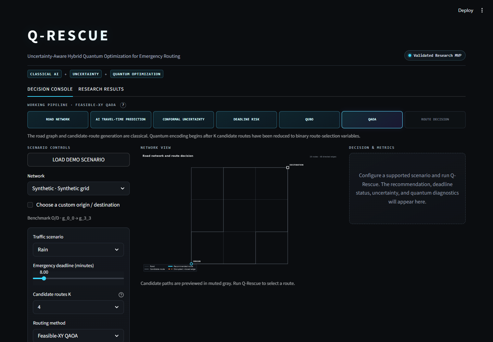

# Q-Rescue

**Uncertainty-Aware Hybrid Quantum Optimization for Emergency Routing**

**Status:** Validated Research MVP · scientific backend frozen

Q-Rescue is a research software project for uncertainty-aware candidate-route selection. It combines classical travel-time prediction, locally scaled conformal intervals, deadline-risk scoring, exact QUBO enumeration, and PennyLane QAOA in an evidence-traceable Streamlit interface.

Q-Rescue originated as a final project for a Quantum AI course at The Egyptian Chinese University (ECU). Ahmed Abdelghafar Mohamed is responsible for the project’s code and is its primary maintainer.

It does **not** claim quantum advantage, quantum speedup, superiority over classical routing, live-traffic validity, medical effectiveness, hardware execution, or operational emergency-deployment readiness.



Deployment URL: [https://q-rescue.streamlit.app](https://q-rescue.streamlit.app/) *(Streamlit Community Cloud may sleep when inactive.)*

## Architecture

```text
CLASSICAL
road network
→ candidate-route generation
→ travel-time prediction
→ conformal uncertainty
→ deadline-risk score
→ exactly-one QUBO construction
                  │
                  ├→ exact classical selection
                  └→ QAOA ideal-simulator optimization  ← QUANTUM SIMULATION
                                      │
                                      → classical decode and route decision
```

The road graph is never encoded node-by-node on qubits. Classical processing first reduces the graph to K candidate routes. Those K route choices become K binary one-hot variables and K qubits. QUBO construction, exact enumeration, decoding, risk evaluation, and visualization remain classical.

The MVP supports five deterministic synthetic topology families, four cached real-road topology case studies with simulated traffic, K=4/6/8 where the graph permits, four routing methods, p=1/2/3, same-scenario comparison, and a controlled dynamic-rerouting demonstration. The presentation default remains the lightweight deterministic synthetic-grid, rain, K=4, feasible-XY, p=1 configuration.

## Run locally

Use Python 3.12 from the repository root:

```powershell
py -3.12 -m venv .venv
.\.venv\Scripts\Activate.ps1
python -m pip install --upgrade pip
python -m pip install -r requirements.txt
python -m streamlit run app.py
```

Open the local URL printed by Streamlit, normally `http://localhost:8501`. The default demo requires no API key, secret, live service, or network download.

See [MVP_GUI_GUIDE.md](MVP_GUI_GUIDE.md) for the operator and backend map, [MVP_DEMO_SCRIPT.md](MVP_DEMO_SCRIPT.md) for a two-minute walkthrough, and [DEPLOYMENT_GUIDE.md](DEPLOYMENT_GUIDE.md) for the reviewed GitHub-to-Streamlit procedure.

## Main research finding

The frozen evidence is deliberately mixed rather than promotional:

- all 1,800 matched Step 9.2 trials were accepted;
- feasible-XY QAOA preserved one-hot feasibility in the ideal simulator, but feasibility did not guarantee exact-optimum concentration or operational utility;
- increasing depth improved concentration without resolving an operational gain;
- traffic and combined distribution shift produced severe conformal undercoverage;
- frozen-model transfer to real road topologies was unfavorable;
- expected-time rerouting outperformed the tested risk-aware QAOA policy on controlled dynamic deadline violations;
- adaptive calibration partly repaired shifted coverage at substantial interval-width cost; and
- the declared local noise model degraded feasible and optimal probability mass.

The authoritative status is [FINAL_RESEARCH_STATUS.md](FINAL_RESEARCH_STATUS.md). Supported and prohibited claims are recorded in [paper/CLAIMS.md](paper/CLAIMS.md).

## Limitations

- No physical quantum hardware run or quantum speedup measurement.
- No observed live-traffic validation, dispatch integration, or medical-outcome study.
- Small candidate-route selection instances; exact enumeration is available and used as ground truth.
- Real-road geometry uses controlled simulated traffic and showed unfavorable frozen-model transfer.
- Custom origin/destination pairs can fail to provide K valid candidates.
- K=8/p=3 and dynamic quantum simulations are heavier interactive configurations.
- No multi-vehicle, fleet-allocation, or city-scale operational claim.

Additional limitations and threats are documented in [paper/LIMITATIONS.md](paper/LIMITATIONS.md) and the frozen research status.

## Tests

The science freeze recorded **158 passing tests**. Install the research/dev dependencies and run the complete suite once from the repository root:

```powershell
python -m pip install -r requirements-research.txt
python -m pytest -q
```

The suite covers scientific modules, artifact contracts, MVP orchestration, cached topology rendering, accessibility source checks, and Streamlit startup. The release pass does not rerun research experiments.

## Reproducibility and artifacts

The immutable science-freeze records validated statistics, adaptive conformal analysis, noise analysis, targeted K=16 scaling, and penalty sensitivity. Runtime values in the Research Results tab are read from saved artifacts; missing values are reported unavailable rather than synthesized.

The ordinary public software repository and complete research archive have different file boundaries. See [GITHUB_RELEASE_GUIDE.md](GITHUB_RELEASE_GUIDE.md) for:

- the exact 6.30 MiB MVP deployment set;
- the 125.83 MiB research-results/archive classification;
- checkpoint and large-file handling;
- manuscript privacy;
- machine-specific path metadata in immutable manifests; and
- Git initialization and staged-file review steps.

Detailed research reproduction notes are in [paper/REPRODUCIBILITY.md](paper/REPRODUCIBILITY.md). Do not regenerate or overwrite frozen result artifacts during ordinary UI or deployment work.

## Citation

A [CITATION.cff](CITATION.cff) file provides the project title, author, and institutional affiliation for citation. Add a DOI or publication details only if they are formally assigned.

## License

Q-Rescue is licensed under the [MIT License](LICENSE).

## Publication safety

The public software repository must be reviewed separately from manuscript/review material. `paper/MANUSCRIPT_DRAFT.md`, `paper/ABSTRACT_DRAFT.md`, related manifests, and other submission-sensitive content remain local by default. TA/supervisor approval should determine whether any of those files are made public.
